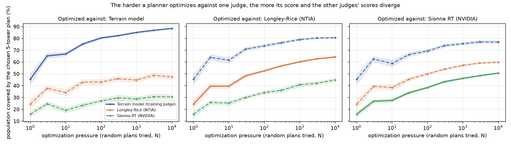
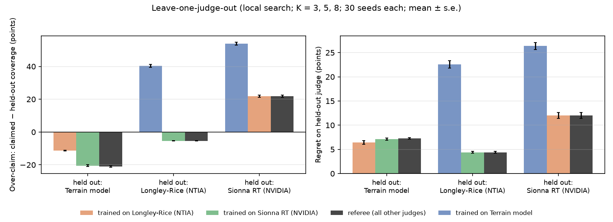
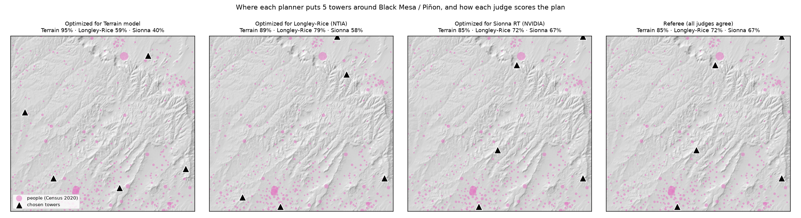

# Safe Planner: catching AI network planners that game their simulator

**When an optimizer places cell towers using one radio simulator, how much of its "coverage" is real, and
does requiring agreement from several independent simulators (a *referee*) stop it from gaming?**
We tested this on real terrain and real population around Black Mesa / Piñon on the Navajo Nation, Arizona.
The three simulators are NVIDIA Sionna RT, NTIA's Longley-Rice model, and a terrain-diffraction model.

Built by Sahi (NVIDIA 6G Developer Program) with Claude as co-builder, September 2026.
It follows from [Coverage Truth](https://github.com/adhabnr-ux/coverage-truth), which found this area among the least-verifiable in Arizona.



## Findings

**Setup:** 7,565 people (Census 2020) in 398 neighbourhood cells. 361 candidate tower sites on a 3 km grid.
Each of 3 judges predicts all 143,678 tower→neighbourhood links. Links: 750 MHz, 30 m towers, 33 dBm EIRP per
resource element, "covered" at RSRP ≥ −105 dBm. Planners pick K = 3, 5 or 8 sites.

1. **Optimizing against one judge inflates its score faster than reality follows (Goodhart).**
   Best-of-N random search, 20 seeds, K = 5. Each N uses fresh random draws, so the curves wobble slightly:

   | Optimized against | Its own score, N = 1 → 10,000 | Longley-Rice | Sionna RT | Terrain model |
   | --- | --- | --- | --- | --- |
   | Terrain model | 45.3% → **88.4%** | 24.4% → 47.4% (flat after N ≈ 300) | 15.9% → 30.6% (flat after N ≈ 300) | — |
   | Longley-Rice | 24.4% → 64.2% | — | 15.9% → 44.8% | 45.3% → 80.6% |
   | Sionna RT | 15.9% → 50.6% | 24.4% → 59.8% | — | 45.3% → 76.9% |

   Pressure against the optimistic terrain model keeps "improving" the plan long after the other two judges
   stop agreeing. Pressure against the stricter judges transfers to every judge.

2. **The referee protects you without knowing in advance which model to trust.** Picking the wrong single judge
   (the optimistic terrain model) over-claims by 40–54 points and loses 23–26 points of reachable population on a
   stricter exam. The referee matches the *best* single judge in 2 of 3 exams and is within 0.9 points in the third.
   Leave-one-judge-out: train on each other judge alone, or on the referee (a person counts as covered only
   if *every* training judge agrees), then grade on the held-out judge. Local search, K = 3/5/8 × 30 seeds
   (90 plans per cell), mean ± s.e., in percentage points:

   | Held-out judge | Trained on | Claimed | Held-out coverage | Over-claim | Regret vs. best plan found |
   | --- | --- | ---: | ---: | ---: | ---: |
   | Longley-Rice | terrain model | 92.1 | 51.8 | **+40.3 ± 1.0** | **22.6 ± 0.7** |
   | Longley-Rice | Sionna | 64.5 | 70.0 | −5.4 ± 0.1 | 4.4 ± 0.2 |
   | Longley-Rice | **referee (terrain + Sionna)** | 64.5 | 70.0 | **−5.4 ± 0.1** | **4.4 ± 0.2** |
   | Sionna | terrain model | 92.1 | 38.2 | +54.0 ± 0.9 | 26.4 ± 0.7 |
   | Sionna | Longley-Rice | 74.4 | 52.5 | +21.9 ± 0.6 | 12.0 ± 0.6 |
   | Sionna | **referee (terrain + Longley-Rice)** | 74.4 | 52.5 | **+21.9 ± 0.6** | **12.0 ± 0.6** |
   | Terrain model | Longley-Rice | 74.4 | 85.7 | −11.3 ± 0.2 | 6.4 ± 0.4 |
   | Terrain model | Sionna | 64.5 | 85.0 | −20.5 ± 0.5 | 7.1 ± 0.2 |
   | Terrain model | **referee (Longley-Rice + Sionna)** | 63.8 | 84.8 | −21.0 ± 0.5 | 7.3 ± 0.2 |

   **The cost of safety:** when the exam judge is the most optimistic one (terrain model), the referee's plans
   reach 0.9 points fewer people than training on Longley-Rice alone, and the referee under-claims by 21 points.
   "Best plan found" is the best plan any of the four planners finds when trained directly on the exam judge.
   It is a strong heuristic optimum, not a proven one.

   **Excess over-claim:** this is over-claim beyond what random plans already show, so it is caused by optimization itself.
   Trained on the terrain model and graded by Longley-Rice it is **+16.0** points; with the referee, **+2.7**.
   All numbers are in [`results/summary.json`](results/summary.json).

3. **An honest twist: here the three judges nest, so the referee becomes "trust the most cautious judge".**
   99.99% of Longley-Rice's covered links are also covered by the terrain model, and 96% of Sionna's are covered by
   Longley-Rice. The consensus therefore behaves like the strictest remaining judge. With Longley-Rice or Sionna as the
   exam, the referee's plans are identical to the strictest single judge's in 100% of runs. With the terrain model as
   the exam they are identical in 72% of runs, and the numbers differ by under 1 point. So the benefit here comes from
   *not trusting the optimistic model*. The referee's value is that it gets this automatically, without you knowing
   which model is optimistic. Whether a referee beats the strictest single model
   depends on the models disagreeing in *both* directions somewhere. That is the most important follow-up:
   other terrain, urban clutter, higher bands.

4. **Reality check against real phones.** In the 41 map tiles with Ookla speed tests (147 tests), we used the 27
   towers known or inferred from carrier claims (Coverage Truth). Each tile is a place where a phone had service,
   so a judge that predicts no signal there is wrong.
   - The terrain model and Longley-Rice predict service at **41/41** tiles.
   - Sionna predicts service at **36/41**, or 92.5% of tests. The likely cause is that Sionna RT models only
     single-edge diffraction: over this terrain it finds any path at all for only 5.6% of planning links. We didn't
     run an ablation to confirm this.
   - Tests can't show where there is *no* service, so this only catches pessimism.

5. **Robust to the coverage threshold:** the same pattern holds at −100, −105 and −110 dBm
   ([`results/sensitivity_threshold.csv`](results/sensitivity_threshold.csv)). For example, the over-claim of
   terrain-trained plans graded by Longley-Rice is +40.0 / +41.1 / +42.0, versus −2.3 / −5.5 / −9.0 for the referee.
   The sensitivity runs use K = 5 only, so the −105 dBm values differ slightly from the main table, which pools K = 3, 5 and 8.




## What this means

- **A single simulator is not a safe grader for an optimizer.** The optimizer finds the model's blind spots.
  Here, valleys where a single knife-edge makes coverage look possible become "wins" that no other model or
  measurement supports.
- **Cheap defence: grade every plan with several models built on different physics**, and report the gap between them.
  In this area it matched the best single model in 2 of 3 exams and cost at most 0.9 points in the third. Trusting the
  wrong single model instead cost up to 54 points of over-claiming and 26 points of coverage.
- **Know what your referee is doing.** If the models nest, a consensus referee is just "trust the most cautious model".
  That is safe but conservative, and it inherits that model's own blind spots. Sionna misses real service in 5 of 41 tested tiles.

## How it works

| Piece | File | Notes |
| --- | --- | --- |
| Environment | `sp/env.py`, `sp/prepare.py` | Census 2020 blocks → H3 res-8 demand; 3 km candidate grid; Copernicus 30 m DEM |
| Judge 1: terrain model | `sp/terrain_model.py` | free space + ITU-R P.526 Bullington knife-edge over the DEM profile (from Coverage Truth) |
| Judge 2: Longley-Rice | `sp/itm.py`, `scripts/build_itm.sh` | NTIA's C++ ITM point-to-point, median; **matches NTIA's reference outputs to 0.01 dB** (`tests/`) |
| Judge 3: Sionna RT | `sp/pathsim.py`, `sp/terrain_scene.py` | NVIDIA Sionna RT 2.1 on a 120 m terrain mesh, LoS + 2 reflections + diffraction, 300k rays/site, CPU |
| Planners | `sp/plan.py` | random, best-of-N, greedy, local search (swap moves + restarts) |
| Referee | `sp/plan.py::PanelObjective` | a person counts only if every judge in the panel covers them |
| Experiments | `sp/experiments.py`, `sp/sensitivity.py`, `sp/reality.py` | E1 Goodhart curves, E2 leave-one-out, thresholds, Ookla check |

A bug caught along the way: receivers placed 1.5 m above a *bilinear* terrain surface can end up *below* the
coarse triangle mesh Sionna actually ray-traces, which silently blocks every ray.
`pathsim.elev_lookup` now interpolates on the exact mesh triangles, and `tests/test_safeplan.py` checks it.
After the fix, the median difference between Sionna and the terrain model is −0.1 dB over the links where Sionna finds a path.

## Reproduce (CPU only, no GPU needed)

```bash
python -m venv .venv && . .venv/bin/activate && pip install -r requirements.txt
bash scripts/build_itm.sh                 # NTIA Longley-Rice shared library
python -m sp.prepare                      # Census demand (DEM tiles download on first use)
python -m sp.judges terrain itm sionna    # ~1 min, ~1 min, ~45 min (Sionna, 2 CPU cores)
python -m sp.experiments                  # ~5 min
python -m sp.sensitivity && python -m sp.reality   # reality check needs ../coverage-truth results
python -m sp.figures && python -m sp.report
python -m pytest -q tests
```

The three 361×398 path-loss matrices are included in `results/path_loss_matrices.npz`, so the planning
experiments can be rerun without Sionna.

## Limits

- One 55 × 58 km area and one link budget. Judges share the same DEM, so terrain-data errors are common to all.
- No judge is ground truth. Ookla tests catch only one error direction and cover 41 tiles.
- Planners are classical optimizers. An LLM-agent planner (and whether it probes for weaknesses) is future work.
- **Sionna's ray count (checked Sept 29).** The Sionna judge used 300,000 rays per site. A later study showed that
  Sionna RT finds more terrain-shadowed paths with more rays, so 6 random candidate sites were re-traced at 10 million
  rays ([`sp/sionna_raycheck.py`](sp/sionna_raycheck.py), [`results/sionna_raycheck.json`](results/sionna_raycheck.json)).
  Links with any path rose from 149 to 225 of 2,388. Links above the −105 dBm coverage threshold stayed at exactly 64, and the
  population they cover stayed at 1,427. The extra paths are all far too weak to count, so the coverage numbers above do not
  depend on the ray count. Where both runs find a path, the gains differ by a median of 2.2 dB.
- NVIDIA AODT would be a stronger fourth judge but needs data-centre GPUs (48 GB+), which this project did not have.

## Data and licences

US Census 2020 TIGER/Line blocks (public domain) · Copernicus GLO-30 DEM (© DLR/Airbus, provided under COPERNICUS
by the EU and ESA) · NTIA ITM (public domain, [github.com/NTIA/itm](https://github.com/NTIA/itm)) · NVIDIA
Sionna RT (Apache-2.0) · Ookla Open Data via Coverage Truth (CC BY-NC-SA 4.0: "Speedtest® by Ookla® Global Fixed and
Mobile Network Performance Maps"). Code: MIT.
